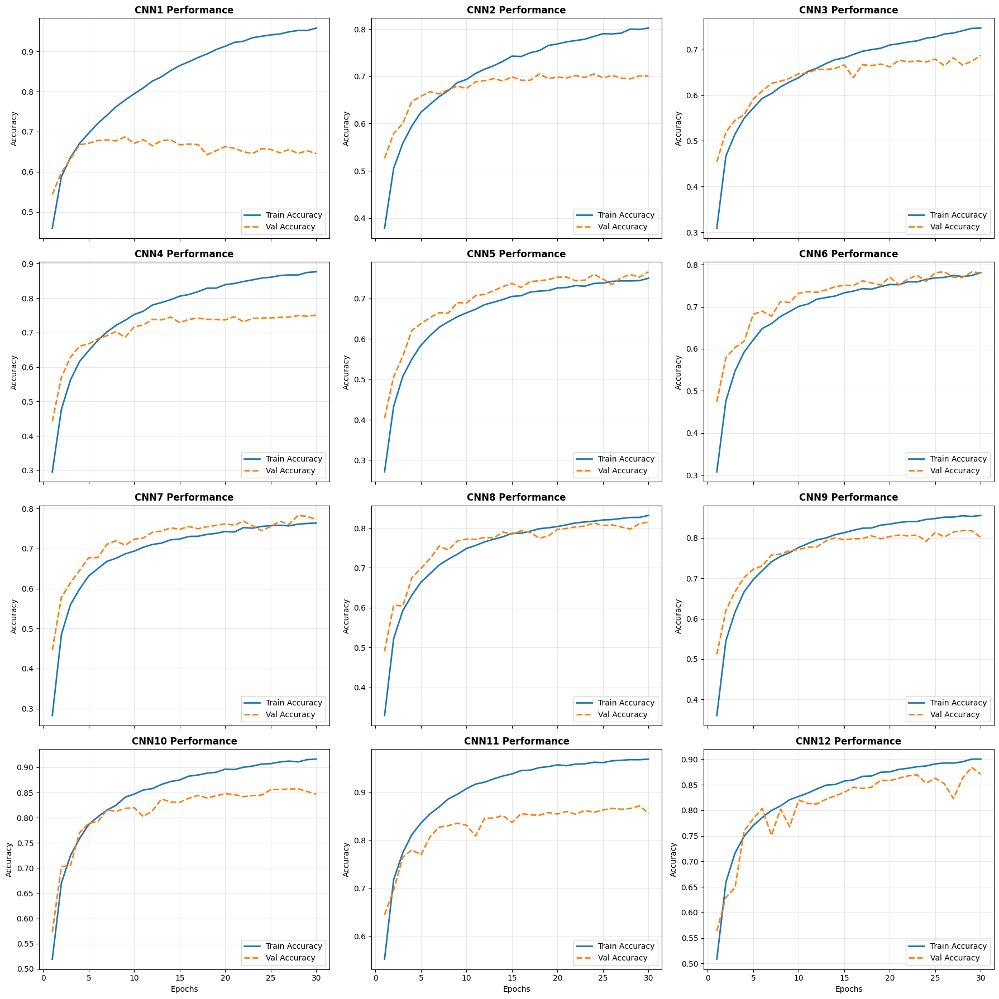

# Iterative CNN Architecture Exploration on CIFAR-10

A systematic, ablation-driven study exploring how convolutional neural network (CNN) design choices impact image classification performance on the **CIFAR-10** dataset. Starting from a simple 2-block baseline (`68.71%` validation accuracy), this project iteratively introduces VGG-style stacked convolutions, spatial dropout, Global Average Pooling, Batch Normalization, filter scaling, and on-the-fly data augmentation—culminating in **`88.41%` validation accuracy** trained from scratch without pretrained weights.

---

## 📊 Experimental Results Leaderboard

All evaluated models were trained from scratch on CIFAR-10 (`32×32×3` RGB images, 10 classes) for **30 epochs** using the Adam optimizer and Sparse Categorical Cross-Entropy loss.

| Rank | Model | Best Val Accuracy | Best Epoch | Total Epochs | Key Architectural Milestone |
| :---: | :--- | :---: | :---: | :---: | :--- |
| **1** | **`cnn12`** | **88.41%** | 29 | 30 | On-the-fly geometric data augmentation (`Flip`, `Translation`, `Zoom`) |
| **2** | **`cnn11`** | **87.10%** | 29 | 30 | Full filter scaling (`64 → 128 → 256`) + `8×8` spatial grid before GAP |
| **3** | **`cnn10`** | **85.74%** | 28 | 30 | `BatchNormalization` added after every `Conv2D` layer |
| **4** | **`cnn8`** | **81.46%** | 30 | 30 | Replaced `Flatten` + `Dense` with `GlobalAveragePooling2D` + `128` filters |
| **5** | **`cnn6`** | **78.30%** | 26 | 30 | Pruned intermediate `64`-unit dense layer from classifier head |
| **6** | **`cnn7`** | **78.28%** | 28 | 30 | Minimal single-layer `Dense(128)` classifier head |
| **7** | **`cnn5`** | **76.64%** | 30 | 30 | Progressive spatial `Dropout(0.2 → 0.3 → 0.4)` after pooling blocks |
| **8** | **`cnn4`** | **75.06%** | 30 | 30 | Switched to `padding='same'` + VGG-style double-conv blocks |
| **9** | **`cnn2`** | **70.52%** | 18 | 30 | Doubled second-block filters (`32 → 64`) + head `Dropout(0.5)` |
| **10** | **`cnn3`** | **68.73%** | 30 | 30 | 3-block `valid`-padded bottleneck (`2×2` spatial collapse) |
| **11** | **`cnn1`** | **68.71%** | 9 | 30 | Unregularized 2-block baseline (`32 → 32`) |

---

## 📈 Training & Validation Curves

Training and validation accuracy progression across the evaluated architectures over 30 epochs:

---

## 🔬 Architectural Progression (`CNN1` → `CNN12`)

* **CNN1 — Baseline Architecture (`68.71%` at Epoch 9):** Uses two convolutional blocks (`32 → 32` filters) with `valid` padding, `MaxPool2D`, `Flatten`, and a `Dense(128) → Dense(10)` head. Establishes the initial CIFAR-10 benchmark without regularization, peaking early at epoch 9 before overfitting.
* **CNN2 — Filter Expansion & Head Regularization (`70.52%` at Epoch 18):** Expands the second block (`32 → 64` filters) and introduces a `Dense(128) → Dropout(0.5) → Dense(64) → Dense(10)` classifier. Delays overfitting to epoch 18 and improves validation accuracy by `+1.81%`.
* **CNN3 — Deeper Bottleneck Exploration (`68.73%` at Epoch 30):** Adds a third convolutional block (`32 → 64 → 32` filters) with `valid` padding and three `MaxPool2D` layers. Compresses feature maps down to `2×2` before flattening, losing spatial detail and dropping accuracy back to baseline levels.
* **CNN4 — VGG-Style Stacked Convolutions (`75.06%` at Epoch 30):** Switches to `padding='same'` across three double-convolution blocks (`(32, 64) → (64, 64) → (64, 64)`) with a three-layer dense head (`128 → 64 → 32`). Preserves border pixels and builds deeper feature hierarchies, delivering a `+6.33%` jump.
* **CNN5 — Progressive Spatial Regularization (`76.64%` at Epoch 30):** Keeps the `cnn4` VGG-style backbone and adds progressive spatial `Dropout(0.2 → 0.3 → 0.4)` after each pooling block. Curbs overfitting in the deeper backbone and lifts validation accuracy by `+1.58%`.
* **CNN6 — Classifier Pruning, Step 1 (`78.30%` at Epoch 26):** Retains the `cnn5` convolutional backbone and trims the dense head to `Dense(128) → Dropout(0.5) → Dense(32) → Dense(10)`. Removes the intermediate `64`-unit dense layer to cut parameter bloat, gaining `+1.66%`.
* **CNN7 — Minimal Dense Classifier, Step 2 (`78.28%` at Epoch 28):** Simplifies the classifier head down to a single `Dense(128) → Dropout(0.5) → Dense(10)` layer while keeping the same convolutional backbone. Matches `cnn6` (`78.28%` vs. `78.30%`) with fewer parameters.
* **CNN8 — Global Average Pooling & Wider Block 3 (`81.46%` at Epoch 30):** Expands the third block to `(128, 128)` filters and replaces `Flatten` + `Dense(128)` with `GlobalAveragePooling2D() → Dropout(0.5) → Dense(10)`. Breaks past the 80% mark (`+3.18%` jump) while slashing classifier parameters.
* **CNN9 — Classifier Dropout Calibration (Not Evaluated):** Keeps the `cnn8` backbone (`(32, 64) → (64, 64) → (128, 128)`) while lowering post-GAP dropout from `0.5` to `0.1` to prevent signal starvation before the final softmax layer.
* **CNN10 — Batch Normalization Stabilization (`85.74%` at Epoch 28):** Adds `BatchNormalization()` after every `Conv2D` layer across the `(32, 64) → (64, 64) → (128, 128)` backbone with `GlobalAveragePooling2D() → Dropout(0.1) → Dense(10)`. Stabilizes activations and drives a `+4.28%` surge over `cnn8`.
* **CNN11 — Full Filter Scaling & Higher Spatial Resolution (`87.10%` at Epoch 29):** Doubles filter capacity across all blocks (`(64, 64) → (128, 128) → (256, 256)`) with `BatchNormalization` and removes the final `MaxPool2D` so `GlobalAveragePooling2D()` averages over an `8×8` spatial grid. Reaches `87.10%` validation accuracy.
* **CNN12 — On-the-Fly Data Augmentation (`88.41%` at Epoch 29):** Prepends `RandomFlip("horizontal")`, `RandomTranslation(0.1, 0.1)`, and `RandomZoom(0.1)` to the `cnn11` backbone (`64 → 128 → 256`) and consolidates trailing dropout into `Dropout(0.3)`. Prevents pixel memorization and achieves the highest score at `88.41%`.

---

## 💡 Key Takeaways

* **Preserving Spatial Dimensions (`+6.33%`):** Switching from `valid` to `same` padding (`cnn3 → cnn4`) prevented tiny `32×32` images from collapsing prematurely, unlocking deeper feature extraction.
* **Batch Normalization (`+4.28%`):** Normalizing activations after every convolution (`cnn8 → cnn10`) produced one of the largest accuracy gains by stabilizing gradient flow across deeper layers.
* **Global Average Pooling (`+3.18%`):** Replacing `Flatten` + large `Dense` layers (`cnn6 → cnn8`) eliminated heavy parameter bloat while acting as structural regularization.
* **Data Augmentation (`+1.31%`):** Adding geometric transformations (`cnn11 → cnn12`) pushed accuracy past `88.4%` and prevented the `256`-filter network from memorizing raw training pixels.

---

## 🛠️ Tech Stack

* **Python 3.8+**
* **TensorFlow / Keras**
* **NumPy & Pandas** (for experiment tracking and leaderboard generation)
* **Matplotlib** (for multi-model training and validation curve visualization)

---

## 🚀 Future Improvements

* **Extended Training + LR Scheduling:** `cnn12` peaked at Epoch 29 out of 30; training for 50 epochs with `ReduceLROnPlateau` and `AdamW` weight decay can push accuracy past `90%`.
* **Residual Connections (ResNet Blocks):** Introducing skip connections via the Keras Functional API to enable deeper feature extraction without vanishing gradients.
